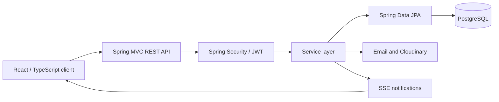

# BookYourSeat — Hybrid Office Reservation Platform


## Overview
BookYourSeat is a team-developed full-stack application for managing shared office spaces in hybrid workplaces. Employees can explore office maps, reserve seats or rooms, manage recurring bookings, coordinate with colleagues and view workplace analytics.

## Engineering highlights
- 11 Spring MVC controller classes and 15 JPA entity classes.
- 65 annotated test methods across five backend test classes; tests have not been executed for this publication package.
- Interval overlap checks for seat and room reservations, recurring booking conflict detection and transactional service methods.
- JWT authentication, password reset, account preferences, notifications and Server-Sent Events infrastructure.
- Interactive React office maps, analytics dashboards and optional Gemini, routing and weather integrations.

## Architecture



## Technology stack

| Backend | Frontend |
|---|---|
| Java 21, Spring Boot 4.1, Maven | React 19, TypeScript, Vite |
| Spring Security, JWT, Spring Data JPA | React Router, Tailwind CSS, Recharts |
| PostgreSQL, Docker Compose | REST API client and interactive office maps |
| JUnit / Spring integration tests, H2 | Gemini, Google Maps Routes and weather services |

## Repository layout

```text
BookYourSeat/
├── backend/   # Spring Boot application, schema, sample data and tests
├── frontend/  # React application, maps, pages and API services
└── README.md
```

## Local development
Install Java 21, a compatible Node.js version, npm, Docker (optional), and PostgreSQL.

### Backend
From `backend/`, copy `src/main/resources/application-local.properties.example` to `src/main/resources/application-local.properties`. Configure the local PostgreSQL connection, JWT secret and optional Cloudinary credentials. Configure SMTP using environment variables if email is needed.

Start PostgreSQL independently, or use `docker compose up -d` after setting `POSTGRES_PASSWORD`. The supplied Compose configuration is mapped to local port 5432 in this package. The example database name is `MyDb`.

On Windows:
```powershell
cd backend
.\mvnw.cmd spring-boot:run
```

On Linux/macOS:
```bash
cd backend
bash mvnw spring-boot:run
```

Backend default: http://localhost:8081.

### Frontend
```bash
cd frontend
npm ci
npm run dev
```

Use the URL printed by Vite. The development proxy forwards backend requests to port 8081. Optional browser-side API keys are described in `.env.example`; use restricted development keys and do not treat VITE-prefixed values as secrets.

### Tests
From backend, run `./mvnw test` (Windows: `.\mvnw.cmd test`). From frontend, run `npm run lint` and `npm run build`.

## Limitations and publication notes
- Review authorization and database-level concurrency guarantees for simultaneous reservations; application-level overlap checks alone do not guarantee race-free booking.
- Review external API usage, secret management and deployment configuration before production use.
- Seed data contains sample account and address records; verify publication rights and replace any real personal data before making the repository public.
- Original SMTP credentials were removed from the supplied configuration. Rotate previously exposed credentials if active.
- This is a team project. Individual contributions and publication permission should be confirmed with the original team; no sole authorship is claimed.
- Build and test execution have not been verified for this archive.
